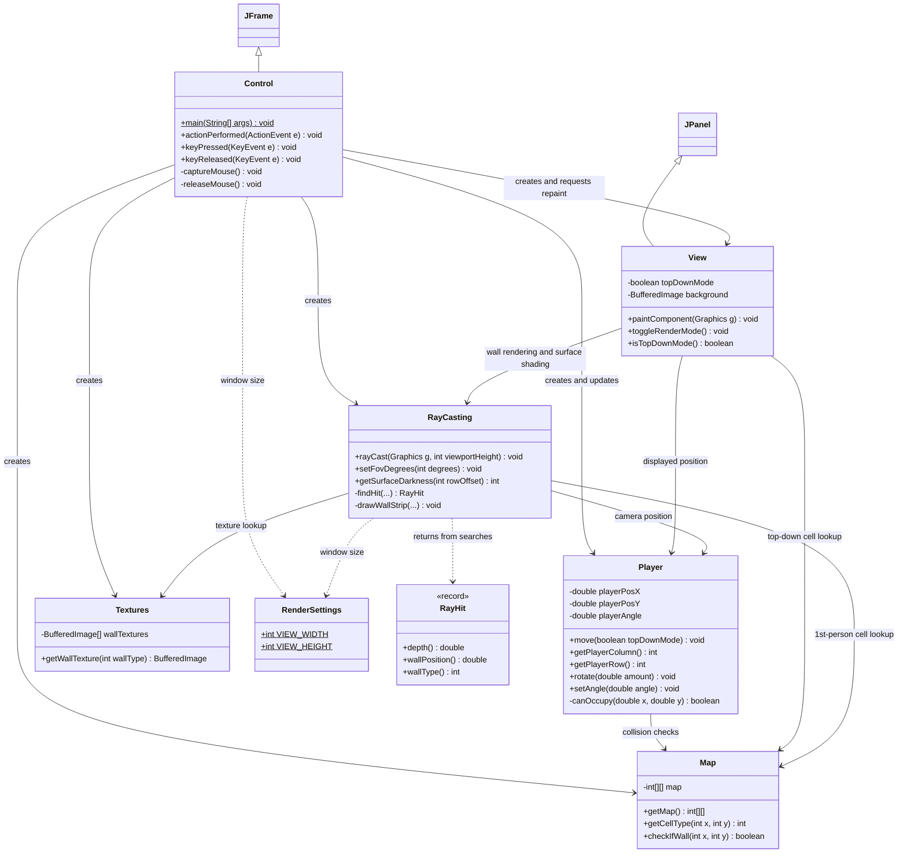
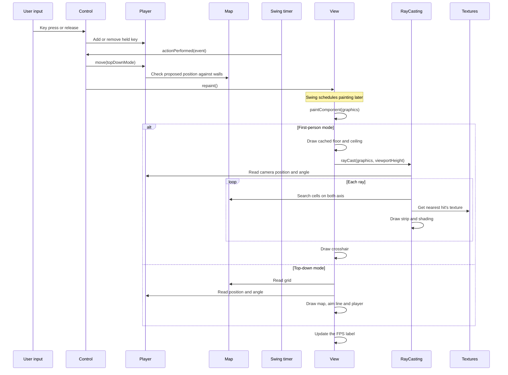

# Architecture

[README](../README.md) · [How does it work?](how-does-it-work.md)

The application has seven top-level classes in `src/main/java/`. `Control` creates
the objects and handles desktop input. `Player` owns movement state. `View` draws
the selected mode and delegates first-person wall rendering to `RayCasting`.
The diagram shows the main relationships, not every method or Swing listener.

## UML class diagram

## Responsibilities

| Class | Responsibility |
| --- | --- |
| `Control` | Window setup, keyboard and mouse input handling, options dialog and update frequency. |
| `Player` | Player position, direction, held keys, movement and collision checks. |
| `Map` | Level cell layout and cell type lookup. |
| `Textures` | Loads texture images and presents them as textures. |
| `View` | First-person/top-down selection, background caching, crosshair, map drawing and FPS overlay. |
| `RayCasting` | Cell-boundary searches, hit selection, projection, texture clipping and distance shading. |
| `RenderSettings` | Holds shared fixed window dimensions. |

## Startup and frame flow

`Control.main()` is the program's entry point. `Control`'s constructor creates one instance of the map,
texture collection, player, renderer and view. The same instances are shared through constructors. 
Textures are loaded before rendering begins. The constructor also registers the input listeners and 
starts a Swing `Timer` with a 10 ms delay, 10ms equals roughly a 100fps target but this value can easily 
be adjusted.

## Technical clarifications

- `RayCasting.rayCast()` reads player state once per frame. It calls `findHit()` for
  each grid axis, selects the nearest result, corrects depth and finally calls 
  `drawWallStrip()`.
- Each search returns an immutable `RayHit` value. Type `0` and infinite depth
  represent no hit (empty). The code creates two records per ray, one for the 
  horizontal axis and one for the vertial axis.
- `Textures` are only read from file and decoded once, they are stored in 
  individual instances of `BufferedImage` and lookup happens on demand. 

## Build

`pom.xml` targets Java 25. It configures PMD 7.28.0 and Checkstyle 14.3.0 and an Exec 
plugin that starts `Control` in a separate JVM. Swing and AWT are supplied by the JDK 
by default so there are no external application dependencies.

Maven compiles `src/main/java/` and copies resources from `src/main/resources/` into 
the same classpath root. `Textures` therefore requests paths such as 
`/tex/greystone.png`. These resources are also packaged in the JAR. The development 
container supplies these build tools and the required X11 libraries.

See the [README](../README.md) for commands, container display permissions and existing 
limitations. See [How does it work?](how-does-it-work.md) for a more in-depth 
details regarding the math and mechanics.
