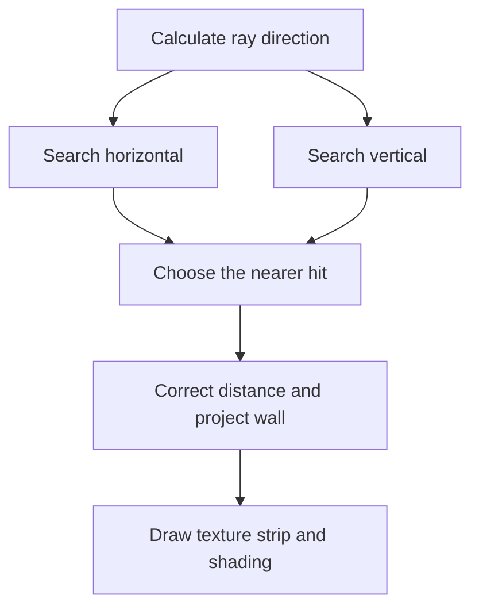

# How does it work?

[README](../README.md) · [Architecture and UML diagram](architecture.md)

The engine builds a first-person image from a two-dimensional grid. It does not use 
any general-purpose 3D renderer.

## A 2D grid that is made to look 3D

Each map cell is one unit wide and one unit deep. A nonzero cell represents a solid
wall. The camera always stays level, halfway between the floor and ceiling and rotates 
around the vertical axis. Those restrictions let the engine draw a three-dimensional 
looking scene from a two-dimensional map.

`Map` stores its grid as `map[row][column]` or `map[y][x]`:

| Cell value | Meaning |
| --- | --- |
| `0` | Empty space |
| `1` | Gray stone wall |
| `2` | Red brick wall |
| `3` | Wood wall |

`getCellType(x, y)` returns that value. Outside the array, it returns `1`, so an
opening at the map edge still meets a solid gray stone boundary. This does not add
cells to the stored map. `checkIfWall(x, y)` asks whether the result is nonzero and
therefore blocks movement.

## Positions and directions

Player positions are floating-point values in map units, so at `x = 3.75`, the player's 
center is three-quarters of the way through column `3`. `getPlayerX()` returns the 
precise position as a double, whereas `getPlayerColumn()` returns `floor(x)`. Rows work 
the same way. Using `floor` makes it able to handle cells with negative coordinates, 
unlike a cast that truncates toward zero.

The map's X direction points right and its Y direction points down. For angle
`a`, the facing vector is:

```text
directionX = cos(a)
directionY = sin(a)
```

Angles use radians. Angle `0` faces right. Angle `pi / 2` faces down. `Math.TAU`
is one full turn. `rotate(amount)` adds a relative turn, while `setAngle(angle)`
sets an absolute direction. The remainder operation removes complete turns but
does not force negative angles to become positive.

## Rays through a projection plane

`RayCasting.rayCast()` casts rays through narrow screen strips. At the default
1600-pixel width it casts 800 rays and each strip is two pixels wide. Rays are
done by pixels on the projection plane rather than by equal angle steps.

Let `W` be the rendering width and `F` the field of view (horizontal FOV) in radians:

```text
screenDist = (W / 2) / tan(F / 2)
screenX = rayIndex * stripWidth + (stripWidth / 2) - (W / 2)
rayAngle = playerAngle + atan(screenX / screenDist)
```

`screenDist` is the distance to that imaginary projection plane, in pixels. The 
increasing the field of view shortens `screenDist` and shows a wider horizontal area.
The projection plane can be visualized as looking through a window. The closer you are 
to it the wider area you can see outside. Whereas if you move further away the window
will show a narrower area. That is why a higher FoV value equals less `screenDist`, 
which might seem counter-intuitive at first glance.

## Finding the wall hit

A ray starting at `(px, py)` follows:

```text
x(t) = px + t * cos(rayAngle)
y(t) = py + t * sin(rayAngle)
```

Because the direction vector has length `1`, `t` is the distance along the ray.
Instead of taking many tiny steps, `findHit()` jumps between the grid boundaries.
It runs twice per ray, once for the horizontal grid boundaries and once for the 
vertical grid boundaries.

For a horizontal boundary at coordinate `yBoundary`:

```text
t = (yBoundary - py) / sin(rayAngle)
xHit = px + t * cos(rayAngle)
```

The next horizontal boundary is one cell above or below it. A vertical search
exchanges X and Y and uses cosine for the boundary-distance calculation.

The method calls the boundary-crossing coordinate `across` and the coordinate along 
the wall `along`. It maps them back to `(x, y)` for each grid lookup. In the case of 
a negative direction, a `0.000001` cell offset is used to make it sample the preceding 
cell rather than the cell on the other side of the boundary.



Each search returns a `RayHit` containing distance, position along the wall and wall 
type. A search that reaches its 20-step limit without a wall returns infinite distance 
and type `0`. If both searches miss, the renderer skips that ray. If distances are 
equal, it chooses the horizontal hit.

## Projection and fisheye effect correction

Uncorrected ray distances grow toward the screen edges even when every ray hits the same
flat wall in front of the player. Using those distances directly would bend its
projected top and bottom edges, creating a fisheye lens effect that we want to avoid.
To fix this the renderer uses perpendicular distance instead:

```text
depth = rayDistance * cos(playerAngle - rayAngle)
projectedHeight = screenDist / depth
wallTop = viewportHeight / 2 - projectedHeight / 2
```

A close wall looks tall, a far away wall looks small. Wall heights and camera height
are static in these formulas as there is no variable height walls or camera pitch in 
this implementation.

## Texture columns and clipping

`Textures` loads each image once. The selected hit supplies its wall type and position 
along the wall:

```text
textureOffset = wallPosition - floor(wallPosition)
textureX = floor(textureOffset * textureWidth)
```

The texture image is repeated once per map cell. A horizontal hit uses its X coordinate 
for this position whereas a vertical hit uses the Y coordinate. `drawWallStrip()` draws 
a 1-pixel wide source column into a wider and taller screen rectangle with 
`Graphics.drawImage()`. It uses the selected image's own dimensions and does not create 
a new subimage for every ray.

An issue to consider is that very close walls can project far beyond the screen. The renderer 
first clips the destination rectangle to the viewport height and then calculates the 
corresponding source rows. Both texture and shading use the bounded rectangle. Simply 
shrinking the destination without cropping the source would squash the entire texture 
into the visible part of the wall. In other words we crop the texture rather than try
to squeeze the entire texture into a single wall strip.

## Distance shading and the background

The floor color, ceiling color and distance shading on the walls is all done via the 
background.

It uses this shared brightness curve:

```text
brightness = 1 / (1 + depth^5 * 0.00002)
darkness = round(255 * (1 - brightness))
```

The renderer draws translucent black over wall strips using `darkness` as the
opacity, more darkness means a wall strip is further away. The ceiling's base color 
is `#232323` and the floor's is `#676767`. For a row at pixel offset `dy` from the 
horizon, a level camera at half a cell above the floor gives:

```text
surfaceDepth = screenDist / (2 * abs(dy))
```

This background does not change when the player moves or turns. `View` caches it
in a 1-pixel wide opaque image and stretches it across the view. It rebuilds the
cache only when the window size or field of view changes. This avoids tons of 
translucent row draws and repeated shading calculations on every frame.

## Movement, collision and timing

`Control` receives key events and adds/removes key codes within a set within 
`Player`. On each update, `Player.move()` reads any held keys from the set. 
First-person movement uses the sine/cosine direction vectors whereas Top-down 
movement uses map axis directly, meaning for example **W** moves the player upwards.
Arrow keys turns the player in either mode.

The player has a circular collision radius of `0.2` map cells, this prevents the 
player from being unnaturally close to a wall. For nearby walls, `canOccupy()` 
finds the closest point on the tile to the player's center. A squared distance 
smaller than the squared radius means overlap. X and Y movement are checked 
separately which allows for some "sliding" along a wall.

## How mouse capture works

Java Swing does not provide the raw relative mouse input through `MouseEvent`. 
`Control` instead implements mouse capture by hiding and re-centering the desktop 
pointer and measuring the offset between update ticks. It basically works like this:

1. A transparent cursor hides the pointer.
2. Mouse events report the offset from the view center.
3. First-person mode calls `rotate(dx * sensitivity)`, vertical movement is ignored
   for aiming. Top-down mode adjusts a virtual aim vector and uses `atan2` to set
   the player's direction.
4. `SwingUtilities.convertPointToScreen()` converts the center to desktop
   coordinates and `Robot.mouseMove()` moves the pointer there.
5. A flag filters the expected event at the center after this move.
